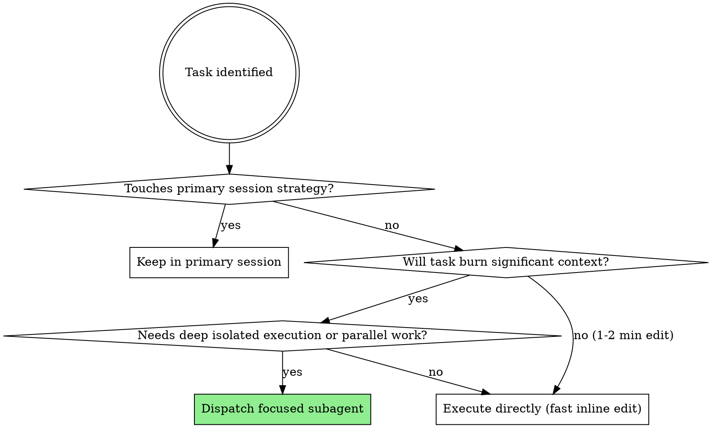

# Subagent Orchestration

## Overview

Subagents are isolated worker sessions with zero inherited conversation memory. Orchestrating them effectively means delegating bounded, non-overlapping tasks with curated context, strict execution constraints, and parent-driven verification upon completion.

**Core Principle:** Primary agent owns architecture, strategy, and verification. Subagents own focused, verifiable execution within strict boundaries.

---

## When to Use



### Delegate to Subagent When:
- **High context consumption:** Deep file searches, massive logs, multi-page API docs, or iterative trial-and-error debugging that would pollute the primary session context.
- **Specialized domain focus:** Heavy backend API/database work, security hardening, or test suite debugging that benefits from a dedicated agent persona.
- **Independent parallel work:** Multiple test files or decoupled subsystems failing with distinct root causes.
- **Spec-driven implementation:** A concrete, well-scoped task from an approved plan with clear acceptance criteria.

### Do NOT Delegate When:
- **Trivial/Mechanical edits:** Modifying a typo, updating a single config line, or running a 1-second terminal command.
- **High ambiguity / Architectural decisions:** Questions that require asking the user for product direction or changing system-level architecture.
- **Shared mutable state:** Two tasks editing the same files simultaneously.

---

## Specialist Subagent Selection

Match the task to the specialist best suited for the work:

| Subagent Type | Primary Focus | Best Used For |
|---|---|---|
| `explore` | Fast codebase navigation | Finding files by pattern, locating symbol references, answering codebase layout questions. |
| `backend` | Implementation & APIs | Business logic, API endpoints, database access, external service integrations, queues. |
| `quality` | Correctness & testing | Test suites, regression reproduction, performance benchmarking, refactoring for clarity. |
| `security` | Threat modeling & hardening | Authentication, authorization, token privacy, input validation, prototype pollution, secrets. |
| `delivery` | Pipelines & environments | Dockerfiles, CI/CD workflows, build scripts, migrations, release packaging. |
| `docs` | Documentation & ADRs | API references, READMEs, changelogs, architecture decision records. |
| `general` | Multi-step research | Tasks spanning multiple domains or requiring open-ended research across files. |

---

## The 4-Part Prompt Architecture

Subagents start with **zero conversation context**. A prompt missing critical context will fail; a prompt dumping the entire conversation will trigger hallucination and waste tokens.

Every subagent prompt must contain these four sections:

```markdown
### 1. Objective & Boundaries
State exactly what needs to be done and what is strictly out of bounds.
- Scope: "Implement secret redaction in src/core/redactor.ts"
- Boundaries: "Do NOT modify src/types.ts or package.json dependencies."

### 2. Curated Context
Provide only the necessary file paths, function signatures, and error traces.
- Files to inspect: "src/core/redactor.ts and tests/redactor.test.ts"
- Current failure: "Test 3 fails: expect(received).toBe(expected)..."

### 3. Execution Constraints
Enforce engineering discipline and safety rules.
- "Follow TDD: run tests before and after changes."
- "Preserve existing exports and backward compatibility."
- "Do not mock internal implementations; test actual behavior."

### 4. Required Output Schema
Demand structured return artifacts rather than conversational chat.
- Status: DONE | DONE_WITH_CONCERNS | BLOCKED
- Files modified
- Verification evidence (test pass count, build output)
```

---

## Workflow Protocols

### 1. Dispatching Pattern

```
Primary Agent (Coordinator)
  │
  ├── 1. Prepare curated prompt (Goal + Context + Constraints + Output Schema)
  ├── 2. Dispatch Subagent (Foreground for dependent work, Background for parallel)
  ├── 3. Subagent executes, runs tests, reports status
  ├── 4. Primary inspects git diff and runs project test suite
  └── 5. Primary integrates changes or sends fix requests
```

### 2. Parent-Side Verification (The Iron Rule)

> **Never trust a subagent's assertion that "all tests pass" without independent verification.**

Upon subagent completion, the primary agent must:
1. Run `git status` and `git diff` to inspect the exact lines modified.
2. Confirm the subagent did not introduce dead code, unwanted dependencies, or security bypasses.
3. Execute the project's test suite (`npm test`, `bun test`, `cargo test`, etc.) directly in the primary workspace.
4. Verify the build artifact (`npm run build`, `bun run build`).

---

## Red Flags & Anti-Patterns

| Anti-Pattern | Why It Fails | Correction |
|---|---|---|
| **Context Dumping** | Pasting 500 lines of conversation history into the subagent prompt. | Extract only the specific error messages, target file paths, and required interfaces. |
| **Vague Goals** | Prompting "Fix the tests" or "Refactor the backend". | Specify exact test file names, expected behavior, and constraints on what not to touch. |
| **Micro-Delegation** | Spawning subagents for 1-line changes or single command executions. | Handle trivial edits directly in the primary session. |
| **Blind Acceptance** | Forwarding subagent output to the user without checking `git diff` or running tests. | Run `git diff` and project tests independently before concluding the task. |
| **Parallel File Collisions** | Dispatching 2 subagents to modify the same file concurrently. | Ensure parallel subagents work on strictly disjoint sets of files. |

---

## Quick Reference

| Step | Action | Command / Tool |
|---|---|---|
| **Decide** | Verify task is bounded and context-heavy | Compare with When to Use chart |
| **Select** | Pick specialist (`backend`, `quality`, `explore`, etc.) | Match task to specialist table |
| **Draft** | Write 4-part prompt | Objective + Context + Constraints + Output |
| **Dispatch** | Launch subagent | `subagent(agent, description, prompt)` |
| **Verify** | Inspect diff and run tests independently | `git diff`, `bun test`, `bun run build` |
